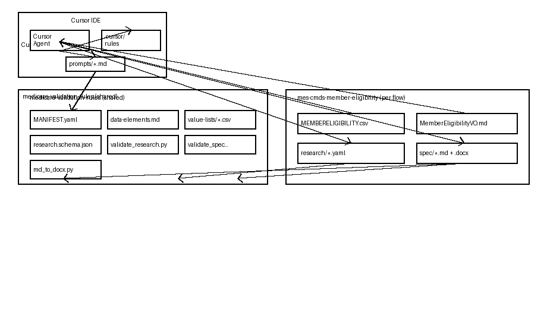
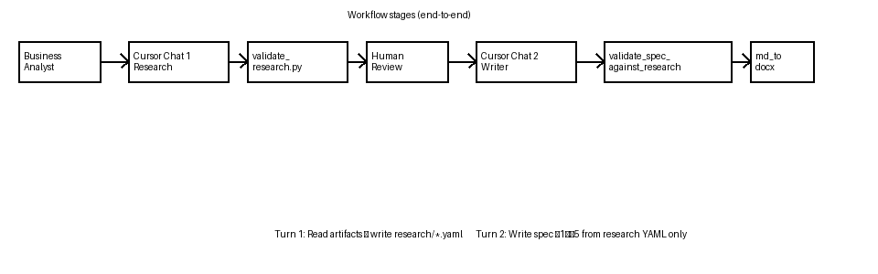
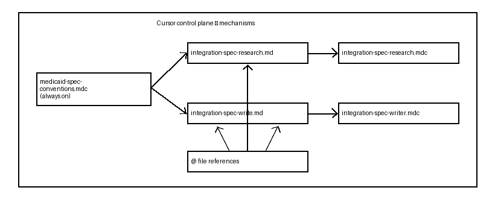

# Integration Specification Creation — Architecture & Workflow

This document describes how MES-to-CMdS **Integration Specifications** are produced in Cursor using a **two-phase, gated** design: structured research first, prose spec second, with Python validators and human review between phases.

---

## 1. System architecture (logical view)

The system splits into three layers: **shared rule library**, **per-integration project**, and **Cursor orchestration** (prompts, rules, agent).



### Repository roles

| Component | Location | Responsibility |
|-----------|----------|----------------|
| **Rule library** | `medicare-validation-rules/` | T-MSIS data elements, VVL CSVs, prompts, schema, validators, conventions |
| **Integration project** | `integrations/mes-cmds-member-eligibility/` | Flow-specific source layout, target VO, research YAML, generated spec |
| **Multi-root workspace** | `mes-cmds-member-eligibility.code-workspace` | Opens both folders so `@rules/`, `@prompts/`, and `@source/` resolve in one chat |

The library is **read-only** for BAs (rules + tooling). Each integration flow owns its **inputs and outputs** only.

---

## 2. Why two phases?

A single prompt that **researches and writes** at once increases risk across many fields (e.g. 113 mappings), multiple VVL files, and dozens of gap categories.

| Single-phase (deprecated) | Two-phase (current) |
|-------------------------|---------------------|
| Agent reads CSV, VO, rules, writes 800+ line spec | Turn 1: cite-only YAML; Turn 2: prose from YAML only |
| Hallucination surface = all artifacts + full spec | Writer never sees raw CSV/VO/rules |
| Hard to review | Human reviews compact `research/*.yaml` before Write |

**Context isolation:** Turn 2 runs in a **new chat** with only `@research/Integration_Research_*.yaml` and the writer prompt so the model cannot rely on invented mappings from Turn 1 file reads.

---

## 3. Workflow stages (end-to-end)



### Orchestrator script (outside Cursor)

The PowerShell orchestrator (`scripts/run-integration-spec-workflow.ps1`) enforces the same stages as this document: setup checks, Turn 1 prompt emission, `validate_research.py`, human **Y/n** approval, Turn 2 prompt with **new chat** reminder, `validate_spec_against_research.py`, and `md_to_docx.py`. It does not run the LLM or modify library `rules/`.

```powershell
.\scripts\run-integration-spec-workflow.ps1
.\scripts\run-integration-spec-workflow.ps1 -SmokeTest   # validator fixtures only
```

See [`Orchestration_Implementation_Plan.md`](Orchestration_Implementation_Plan.md) for rollout phases and RACI.

---

### Stage 0 — Workspace setup

1. Open **both** roots (workspace file or Add Folder to Workspace):
   - `integrations/mes-cmds-member-eligibility`
   - `medicare-validation-rules` (sibling: `../../medicare-validation-rules`)
2. Install Python deps (from integration folder):

   ```powershell
   pip install -r ..\..\medicare-validation-rules\requirements.txt
   ```

3. Optional: install [Pandoc](https://pandoc.org/installing.html) for Word export.

Always-on rule: `medicaid-spec-conventions.mdc` (cite-never-invent, provenance). Phase rules are invoked via `@` in each turn's prompt.

---

### Stage 1 — Research (Turn 1)

**Goal:** Produce a structured, version-controlled **research artifact** — not spec prose.

| Mechanism | Path / behavior |
|-----------|-----------------|
| Procedure | `prompts/integration-spec-research.md` |
| Phase rule | `@.cursor/rules/integration-spec-research.mdc` (`alwaysApply: false`) |
| Inputs | `source/*.csv`, `target/*VO.md`, `rules/eligibility/data-elements.md`, `value-lists/*.csv` |
| Output | `research/Integration_Research_MemberEligibility.yaml` |
| Contract | `schemas/integration-research.schema.json` |

**Research agent constraints:**

- Read-only on inputs; every fact has `source_ref` (`file:Lnn`).
- `gaps[]` only — `assumptions: []` (no ASM at research time).
- `field_mappings[]`: one row per source field; `derivation` = `DIRECT` | `INFERRED` | `UNMAPPED`.
- `vvl_members[]`: verbatim CONFIRMED CSV rows with per-row `source_ref`.
- `meta.sources[]`: paths + SHA-256 checksums for provenance.

**Gate:**

```powershell
python ..\..\medicare-validation-rules\tools\validate_research.py research\Integration_Research_MemberEligibility.yaml
```

Checks: JSON Schema, dictionary version vs `MANIFEST.yaml`, empty assumptions, DE ids in `data-elements.csv`, VVL row parity, optional SHA-256 match.

---

### Stage 2 — Human review (HITL gate)

The BA/SME reviews the YAML (mappings, gaps, VVL members) — typically far smaller than a full spec. This is the intended checkpoint before any narrative or placeholder behavior is written.

No Cursor automation here; approval is procedural.

---

### Stage 3 — Writer (Turn 2, new chat)

**Goal:** Transcribe approved research into the Integration Specification (§1–§5).

| Mechanism | Path / behavior |
|-----------|-----------------|
| Procedure | `prompts/integration-spec-write.md` |
| Phase rule | `@.cursor/rules/integration-spec-writer.mdc` |
| **Only input** | `@research/Integration_Research_MemberEligibility.yaml` |
| Outputs | `spec/Integration_Spec_....md` (canonical), then `.docx` |

**Writer constraints:**

- No new field mappings, VVL codes, or GAP IDs beyond research.
- No `ASM-NN` unless present in research `assumptions` (empty on first pass).
- §3 echoes research `source_ref` / `target_ref`; §2.2 lists research `gaps`.

**Gates (order matters):**

```powershell
python ..\..\medicare-validation-rules\tools\validate_spec_against_research.py research\Integration_Research_MemberEligibility.yaml spec\Integration_Spec_MES_to_CMdS_MemberEligibility.md
python ..\..\medicare-validation-rules\tools\md_to_docx.py spec\Integration_Spec_MES_to_CMdS_MemberEligibility.md
```

`validate_spec_against_research.py` checks §3 field parity, §4.D VVL codes ⊆ research, §2.2 GAP ids, and ASM gate when assumptions are empty.

---

## 4. Cursor control plane

Cursor does not ship separate "Research Agent" and "Writer Agent" products. Behavior is enforced by:



| Mechanism | Research | Writer |
|-----------|----------|--------|
| Prompt file | `integration-spec-research.md` | `integration-spec-write.md` |
| Cursor rule | `integration-spec-research.mdc` | `integration-spec-writer.mdc` |
| Agent input scope | All flow artifacts | Research YAML only |
| Deliverable | `research/*.yaml` | `spec/*.md` + `.docx` |
| Validator | `validate_research.py` | `validate_spec_against_research.py` |

Deprecated entry point: `integration-spec-generation.md` redirects to the two-phase flow.

---

## 5. Research artifact model (contract)

The research YAML is the **structured source of truth** between phases:

| Section | Purpose |
|---------|---------|
| `meta` | Flow name, T-MSIS `dictionary_version`, input file paths + SHA-256 |
| `field_mappings[]` | Source ↔ target mapping with citations and optional `t_msis_rule` / `vvl_file` |
| `gaps[]` | Missing facts (`GAP-NN`, evidence, owner, priority) |
| `assumptions[]` | Empty at research; BAs may fill later |
| `vvl_members[]` | Confirmed enum rows copied from VVL CSVs |

The Writer **transcribes** this into normative spec sections:

| Spec section | Source in research |
|--------------|-------------------|
| §1 Executive summary | `meta` + pipeline narrative from writer prompt |
| §2 Gaps & assumptions | `gaps[]`, `assumptions[]` |
| §3 Mapping matrix | `field_mappings[]` |
| §4.D/E VVL tables | `vvl_members[]` |
| §4.F Rule index | `field_mappings[].t_msis_rule` |

---

## 6. Deterministic tooling (non-LLM gates)

LLM rules reduce drift; validators **fail the pipeline** on structural violations:

| Tool | When | What it enforces |
|------|------|------------------|
| `validate_research.py` | After Turn 1 | Schema, refs, empty assumptions, DE/VVL integrity, checksums |
| `validate_spec_against_research.py` | Before Word export | Spec does not exceed research (fields, VVL codes, GAPs) |
| `md_to_docx.py` | After validation | Markdown → Word via Pandoc |
| `xlsx_to_text.py` | Rule maintenance | Regenerate `data-elements.md/csv` from `source.xlsx` |

Provenance registry: `MANIFEST.yaml` pins dictionary **v4.0.33** and paths to prompts, schema, and validators.

---

## 7. Data flow summary

```text
INPUTS (integration + library)
  MEMBERELIGIBILITY.csv + .CPY
  MemberEligibilityVO.md
  data-elements.md + value-lists/*.csv
        |
        v  Turn 1: Research Agent + validate_research.py
  research/Integration_Research_MemberEligibility.yaml
        |
        v  Human review
        |
        v  Turn 2: Writer Agent + validate_spec_against_research.py
  spec/Integration_Spec_....md
        |
        v  md_to_docx.py
  spec/Integration_Spec_....docx
```

---

## 8. Operational limits

- **Research quality** still depends on the model; validators catch schema and many consistency errors, not semantic mapping mistakes — that is what the YAML review gate is for.
- **Spec validator** uses pragmatic Markdown parsing (regex/tables); edge-case formatting may need validator tweaks.
- **Always-on rules** apply in both chats; phase rules are narrower and must be `@`-referenced in prompts to steer behavior strongly.
- **Headless/CI:** The same two prompts can map to Cursor SDK (`Agent.prompt` twice) later; validators are already scriptable.

---

## 9. Quick reference — BA prompts

**Turn 1 — Research**

```text
Run Integration Spec Research per @prompts/integration-spec-research.md.
- Flow: Member Eligibility
- Source layout: @source/MEMBERELIGIBILITY.csv
- Target VO: @target/MemberEligibilityVO.md
- Validation rules: @rules/eligibility/data-elements.md
- Value lists: @rules/eligibility/value-lists/

Write research/Integration_Research_MemberEligibility.yaml only. Do not write the spec.
```

**Turn 2 — Writer (new chat)**

```text
Write Integration Specification per @prompts/integration-spec-write.md from
@research/Integration_Research_MemberEligibility.yaml only.

Deliver spec/*.md and run tools/md_to_docx.py for .docx.
```

---

*Generated from the MES-to-CMdS Member Eligibility integration project. Canonical Markdown: `docs/Integration_Spec_Creation_Architecture.md`.*
